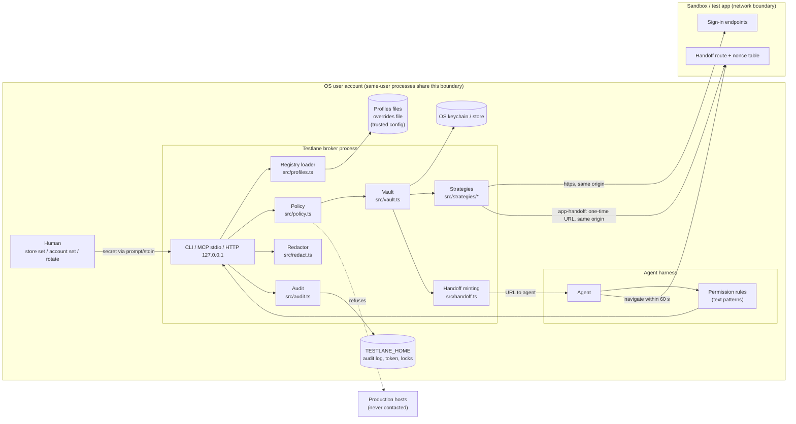

# Threat model

This document describes what Testlane protects, from whom, where it draws its trust boundaries, and
what risk remains after its mitigations. It is written to be checked against the code: every
mitigation names the file that implements it. Where a mitigation is partial, the residual risk
says so plainly. It describes Testlane 0.6.0 (`@testlane/cli`). It holds the rules the
code enforces (inside the threats they answer, plus section 7), the trust model (section 4) and
the known limits (section 9).

Reporting a problem: see [SECURITY.md](../SECURITY.md).

## 1. What Testlane is for

Coding agents need to sign into **sandbox and test** web applications to verify their work. Testlane
lets them do that without ever holding a password:

1. A human stores each account's secret once (`testlane store set <profile>`, prompt or stdin only).
2. The secret lives in the OS keychain (or an AES-256-GCM file whose key is in the keychain).
3. When an agent asks for a session, the broker checks policy, loads the secret, performs the
   sign-in itself, writes an audit row, and returns only a session artifact: a cookie header, a
   Playwright `storageState`, a curl cookie jar, header lines, or a one-time handoff URL.

The core claim is narrow: **the agent never sees a secret, and never gets a production
session.** It is not a claim that the agent cannot misuse the sandbox session it was given.

This holds for every strategy alike. In particular, since 0.4.0 an agent can obtain a **session
artifact for an `app-handoff` profile** (`session`, and as the `dependsOn` of a
`dependent-token` profile) **once a human has opted that profile in with `options.mePath`**: the
broker consumes the one-time handoff URL itself and returns the cookies the app set. That
artifact has **the same trust level as any other strategy's session artifact** (T9): a live
sandbox session for the account, reusable until the app expires it, including the HttpOnly
cookie a navigate-only browser never exposed. It is no longer only a 60-second, single-use URL.
A profile without `mePath` is refused as in 0.3.x, so an upgrade grants nothing by itself.

## 2. Assets

| Asset | Where it lives | Why it matters |
| --- | --- | --- |
| Stored secrets (passwords, PINs, handoff secrets) | OS store, via `src/store/*`; envelope format in `src/vault.ts` | Reusable indefinitely; may be shared with other tools or people |
| Pending rotated secret | Same envelope (`pendingSecret`) during a rotation | Becomes the live secret if the app applied the change |
| encrypted-file data key | OS keychain entry `encrypted-file.key.v1` | Decrypts every entry in an encrypted-file store |
| Session artifacts | Agent stdout / MCP result / HTTP body, or a `--out` file | Live credentials for the account until the app expires them |
| Handoff codes and URLs | Agent output, then the browser's address bar (`handoff`); or only inside the broker and its request to the app (`session` / `check` on an `app-handoff` profile) | A 60-second bearer credential for a full session |
| Production accounts and hosts | Not held by Testlane, by design | The broker must never reach them |
| Audit log | `<TESTLANE_HOME>/audit.ndjson` | The record of who got which session |
| HTTP bearer token | `<TESTLANE_HOME>/http-token[-<port>]` | Grants the localhost HTTP surface |
| Profiles and overrides files | repo `testlane.profiles.json`, user-level profiles file, `<TESTLANE_HOME>/testlane.overrides.json` | Decide which endpoint receives which secret for which account |

## 3. Actors

| Actor | Capability | Intended trust |
| --- | --- | --- |
| **The human** (machine owner) | Runs `store set`, `store delete`, `account set/clear`, `rotate`; edits profiles; configures the harness | Fully trusted |
| **The agent** (Claude Code, Codex, any shell- or MCP-capable tool) | Runs allowlisted commands; calls MCP tools or the HTTP server; reads and writes the working tree | Trusted to follow instructions, not trusted with secrets |
| **A compromised agent** (prompt injection from a web page, issue, dependency README or tool output) | Everything the agent can do, steered by an attacker | Untrusted |
| **A malicious registry edit** (a pull request, a compromised dependency, an agent writing a profiles file) | Changes `baseUrl`, `strategy`, `options`, `account`, `environment` of profiles | Untrusted content in a trusted file |
| **A network attacker** | Observes or modifies traffic between the broker and the app | Untrusted |
| **A co-tenant process** running as the same OS user (another tool, a malicious package's install script) | Reads the user's files, calls the user's keychain | Not distinguishable from the user by the OS |

## 4. Trust boundaries

1. **The OS keychain / store.** Secrets cross into the broker process only through
   `src/vault.ts`. The store protects them at rest from other users and from offline disk
   access. It does **not** protect them from processes running as the same user.
2. **Profiles files, `TESTLANE_HOME`, `TESTLANE_PROFILES`.** The profiles files are the repo's
   `testlane.profiles.json`, the `--profiles` file and the user-level file; the two variables
   also have pre-rename `AGENT_AUTH_*` fallbacks. All of them are trusted configuration. Whoever
   controls them decides which apps the broker signs into, where the store and audit log live,
   and which same-origin endpoint receives a secret. Origin binding, option validation and the
   production host denylist narrow the damage of a hostile edit (section 6, T5) but do not make
   these inputs safe to accept from an untrusted party.
3. **The harness permission layer.** The agent's harness decides which commands run without a
   prompt. This is a useful boundary for human-only commands, but it matches text, so it is
   treated as defence in depth, never as the only control (T14).
4. **The broker's agent surfaces.** CLI, MCP (stdio) and HTTP (127.0.0.1) offer the same
   read-and-sign-in operations. None of them can write a secret, change an account override or
   rotate; those exist only on the CLI for the human.
5. **The app's sign-in endpoints and handoff route.** The broker trusts the app to authenticate
   the account it names and, for `app-handoff`, to implement
   [HANDOFF-ROUTE-CONTRACT.md](HANDOFF-ROUTE-CONTRACT.md) correctly.

### Account overrides

`testlane account set|clear|list` is human-only. Some sandboxes rotate the test account's email on
every environment run, which the committed registry cannot track and the user-level profiles file
cannot shadow (duplicate names are refused by design). The overrides file,
`<TESTLANE_HOME>/testlane.overrides.json`
(`{ "version": 1, "overrides": { "<profile>": { "account": { "email"?, "identifier"? } } } }`),
is strict: any other key anywhere is an invalid-profile error naming the file.

- An override can change **only the account identity** (`account.email`, `account.identifier`)
  of an **existing, non-production** profile. `baseUrl`, `environment`, `strategy`, `options`,
  `allowedHosts` and `session` stay policy-bearing and repo-owned. Overrides are applied after the
  repo/user merge.
- The file is machine-global (shared by every repo), so an override whose profile is not in the
  current registry is **ignored**: it is listed in `unusedOverrides`, `profiles`, `session`,
  `check` and `handoff` print one stderr line per such entry (never fatal), and `account list`
  marks it `(unused here)`.
- An override for a profile that exists but is tagged `production` is an invalid-profile error
  (exit 2) on every command until it is removed with `testlane account clear <profile>` (which
  works on the file alone).
- The stored secret stays bound to origin + environment only, so changing the override email
  needs no new `store set`; a wrong override just fails sign-in (exit 3).

### Requester label

`--requester` (or `TESTLANE_REQUESTER`) is recorded for the audit log only. It is sanitised to
`[A-Za-z0-9:._-]`, at most 64 characters, and it is not authentication. For `mcp` and `serve` the
default is `--requester`, else `TESTLANE_REQUESTER` (for example set in the MCP client's server
`env`), else `mcp` / `http`.

## 5. Diagram

## 6. Threats, mitigations and residual risk

### T1. Secret on the command line, in the environment or in shell history

- **Mitigation.** `store set` reads only from a prompt or stdin, and after `store set` only the
  profile name is accepted. Any extra argument, any flag (global ones included), any
  `--flag=value`, or a secret-looking flag anywhere on the line is refused with exit 5 before stdin
  is read, and the argument is not echoed. Unknown `--option=value` on other commands is refused the
  same way. Secrets are never read from environment variables (the encrypted-file passphrase is
  interactive-only). `src/cli.ts`, `src/store/input.ts`, `src/store/encrypted-file.ts`.
- **Residual.** stdin is an input channel the agent can use: an agent that is allowed to run
  `store set` can pipe a value into it. That is why `store set` is a human-only command in the
  permission rules (T14). Child processes of the store adapters receive secrets on stdin, never
  argv (`src/store/dpapi.ts`, `src/store/keychain-macos.ts`, `src/store/secret-service.ts`).

### T2. Secret in output, logs, transcripts or error messages

- **Mitigation.** Every loaded secret (current and pending) is registered with a process-wide
  redactor (`src/vault.ts`), which scrubs the raw value and its JSON-escaped, URL-encoded,
  form-encoded, base64 and base64url forms (`src/redact.ts`). It applies on every surface: CLI
  stdout/stderr, the `session --out` file, MCP text and structuredContent, and every HTTP body
  (`src/cli.ts`, `src/mcp.ts`, `src/serve.ts`). User-facing errors go through `safeError`
  (message only, never a stack). The HTTP server logs method, path, status and time only
  (`src/serve.ts`). MCP errors carry a safe message and a code (`src/mcp.ts`).
- **Residual.**
  - A secret split across two separate `write` calls, or embedded at a non-aligned offset inside
    a larger base64 blob, is not detected. Hex and other encodings are not covered.
  - Short all-digit secrets (PINs under 12 digits) are deliberately not registered: scrubbing
    their digits would corrupt cookies, ports and timestamps that happen to contain them. The
    broker never prints a PIN, but nothing scrubs one if it appears.
  - The redactor protects the broker process only. If the app echoes a password in a page the
    agent later browses, Testlane cannot see it.
  - Session artifacts are printed on purpose. They are not secrets in this model, but they are
    live credentials (T9).

### T3. Secret in the audit log

- **Mitigation.** Rows are validated against a strict schema, every string is capped at 512
  characters, and the free-text fields (`reason`, `format`) are refused outright if they look
  like a `password=` / `token:` assignment; the error never echoes the value. `src/audit.ts`.
- **Residual.** The assignment check is a heuristic on two fields. Other fields (profile, host,
  requester) are validated or sanitised where they are produced, not scanned for secrets.

### T4. An agent gets a production session

- **Mitigation.** A profile tagged `production` is refused on every surface with no flag,
  environment variable or interactive bypass. Hostnames of production profiles form a denylist.
  A non-production profile whose `baseUrl` or `allowedHosts` share a hostname with a production
  profile, on any port and in any spelling the URL parser normalises (case, trailing dot, IPv6
  compression, IPv4-mapped IPv6 such as `[::ffff:10.0.0.5]`, short or decimal IPv4 such as
  `127.1`), is rejected when the registry loads. The check also runs on the merged repo +
  user-level registry, so a production entry in one file protects against an overlapping profile
  in the other. A session whose base or `--target` hostname is on the denylist is refused.
  `allowedHosts` entries must parse as a host (lowercase, no trailing dot; an unparsable entry
  fails at load) and are stored in canonical form, so every comparison above works on one
  spelling. `src/policy.ts` (`assertAllowed`, `canonicalHostEntry`), `src/profiles.ts`
  (`productionHosts`, `productionOverlapIssues`). `store set` refuses a production profile, and a
  profile whose base or allowed host belongs to a production profile, so the vault never holds a
  production secret (`src/vault.ts`, `src/commands.ts`).
- **Residual.** The broker only knows production hosts that the registry declares. A profile
  that points at an undeclared production host is not recognised as production. Declare every
  production host as a `production` profile, even if nothing signs into it, and make the app's
  own agent-only surfaces refuse production (see [playbook/02-environments.md](playbook/02-environments.md)).
  Only IPv4-mapped IPv6 is folded onto IPv4; see the known limits in section 9.

### T5. A malicious or mistaken registry edit

- **Mitigation.** Each secret is stored in an envelope bound to the profile's `baseUrl` origin
  and environment tag at store time; a mismatch is refused with exit 6 (`src/vault.ts`,
  `loadEnvelope`), so re-pointing a profile at another host, port or scheme, or re-tagging it,
  does not move the secret. Strategy options are validated per strategy: only documented keys,
  and every endpoint option must be a same-origin path (`src/strategies/options.ts`, checked at
  load and again before the request; this includes the `rotate*` endpoint options). Off-origin
  redirects during sign-in are refused. Account overrides may change only `account.email` /
  `account.identifier` of an existing non-production profile (`src/profiles.ts`).
- **Residual.** Edits that keep origin and environment are accepted: a changed `strategy`,
  `loginPath`, `fields`, `mePath`, `handoffPath`, `rotatePath`, `rotateVia` or account email can
  send the stored secret to a different endpoint on the same origin, or with a different email.
  On a shared origin, that endpoint might log request bodies. For `app-handoff`, a changed
  `handoffPath` or `mePath` sends one-time codes (never the handoff secret) or the captured
  session to another path on the same origin. Treat profiles files like code: review them, and
  never let an agent write them or pass its own (`--profiles`, `TESTLANE_PROFILES`).

### T6. An agent swaps the registry or the broker home

- **Mitigation.** Global options (`--profiles`, `--requester`, `--json`) are accepted only
  before the subcommand, so a command that matches an allowlisted prefix such as
  `testlane session …` cannot carry a different registry (`src/cli.ts`; the option rules are in
  [cli.md](cli.md#global-options)). The shipped rules deny `--profiles` before or after
  the subcommand for each documented launcher. They also deny references to `TESTLANE_HOME`,
  `TESTLANE_PROFILES` and their legacy names, including environment-prefixed calls.
  Other global options or unlisted launchers may require separate approval; text rules
  do not isolate a hostile process running as the same OS user.
- **Residual.** `TESTLANE_HOME` moves the audit log, the DPAPI and encrypted-file store
  directories, the overrides file and the HTTP token. With the DPAPI or encrypted-file store an
  alternative home is simply empty. With `keychain-macos` or `secret-service` the secrets are
  keyed by profile name in the user's keychain, **not** under `TESTLANE_HOME`, so a process
  with an alternative home can still use them while writing its audit rows elsewhere. The
  harness must not auto-approve environment-prefixed broker commands.

### T7. Handoff code forgery

- **Mitigation.** `code = base64url(profile.nonce.expiry) + "." + base64url(HMAC-SHA256(secret,
  payload))`. The secret must be at least 32 characters (refused by `store set`, mint and
  verify). The reference verifier checks shape and canonical base64url, compares the signature in
  constant time **before** interpreting the payload, and rejects codes longer than 1024
  characters. `src/handoff.ts` (`mintHandoffCode`, `verifyHandoffCode`).
- **Residual.** A code carries no audience: every deployment that shares the secret accepts it.
  Use one secret per deployment ([HANDOFF-ROUTE-CONTRACT.md](HANDOFF-ROUTE-CONTRACT.md)). The app
  route is the app's code; a route that skips or weakens verification is outside Testlane's control.

### T8. Handoff URL replay or theft

- **Mitigation.** 60-second lifetime, codes further than 60 s + 30 s skew in the future are
  rejected, and a 16-byte nonce must be accepted exactly once by a nonce store shared across
  every instance (the contract specifies a unique-keyed database table; `MemoryNonceStore` in
  `src/handoff.ts` is for tests and single-process servers only). Every handoff is audited
  before the URL is printed. For `session` / `check` on an opted-in `app-handoff` profile the
  broker consumes the URL itself: no code is minted unless the app's host and port accept a TCP
  connection; the code is audited (reason `consumed-by-broker`) before it leaves the process
  (and a `consumed-by-broker:no-answer` row follows if the request gets no answer), is sent
  only to the profile origin with `redirect: manual`, is burned by the route on that request,
  and is never printed, logged or placed in an error. Any failure after the mint adds a failed
  `session` / `check` row. A non-3xx answer or an off-origin redirect refuses the session. Cookies are captured host-only: a cookie carrying any `Domain`
  attribute (another domain, a parent domain, or the host itself) is dropped, as is one that
  breaks the `__Secure-` / `__Host-` rules, and the session is refused only if no usable
  cookie remains (`src/strategies/app-handoff.ts`, `src/http/cookie-jar.ts`).
- **Residual.** Until it is used, a `handoff` URL is a bearer credential: whoever opens it first
  within 60 seconds gets the session. It passes through the agent's transcript and the browser's
  history. A broker-consumed code never reaches the transcript, but the session it produced does
  (T9). A per-instance (in-memory) nonce store in a multi-instance deployment allows replay.

### T9. Session artifact theft and lifetime

- **Mitigation.** A requested TTL above `min(profile ttlMinutes, 480)` is refused, not capped
  (`src/policy.ts`). `session --out` writes a new file with mode 0600 and never overwrites one
  without `--force`: the check happens before signing in, the write itself uses create-only
  mode, and the error names the path only (`src/cli.ts`). The shipped rules deny `--force`. `check` discards its
  session and prints identity only (`src/commands.ts`).
- **Residual.** **`ttlMinutes` is advisory for cookie strategies.** It bounds the artifact's
  `expiresAt` and cookie expiry, but the app's server-side session lifetime (for example a JWT
  `maxAge`, often 30 days by default) decides how long a copied cookie value really works, and
  client-side refresh can extend it. Enforce the TTL in the app's session callback
  ([playbook/03-sign-in.md](playbook/03-sign-in.md)); the handoff route, which mints the app's own
  session with `maxAge` = `ttlMinutes` whether a browser opens the `handoff` URL or the broker
  consumes it for `session`, is the way to get server-side TTL enforcement. A `dependent-token`
  artifact can contain the dependency account's full web session. MCP returns the artifact
  inline, so it lands in the conversation
  context; use the CLI with `--out` when that is not wanted.
- **app-handoff sessions.** Since 0.4.0 an agent can hold a session artifact for an
  `app-handoff` profile, and a `dependent-token` artifact can carry the session of a
  password-less `app-handoff` device, **but only for profiles a human opted in with
  `options.mePath`**. Without it `session`, `check` and a dependency on the profile are refused
  (exit 2) before the store is read or a code is minted, exactly as in 0.3.x, so an upgrade
  does not quietly hand agents a cookie they could not hold before. For an opted-in profile
  this is deliberate and puts the artifact at exactly the trust level of every other strategy's
  artifact: a live session for the account, reusable until the app expires it (the route mints
  it with `maxAge` = `ttlMinutes`), rather than a URL that works once within 60 seconds. The
  broker also confirms at `mePath` that the route minted the session for the profile's account
  before handing it out. Re-check an account's privileges before opting its profile in: it
  needs the same least-privilege care as a password account.

### T10. A co-tenant process running as the same OS user

- **Mitigation.** None beyond the OS. DPAPI entropy (`agent-auth-vault/v1`) only namespaces and
  versions the ciphertexts. The HTTP token file is mode 0600 in a 0700 directory on POSIX.
- **Residual.** **DPAPI, the macOS login keychain and Secret Service are user-scoped.** Any
  process running as the same user can decrypt the store, read the HTTP token, read session files
  and edit the audit log. Testlane removes plaintext secrets from disk and from agent transcripts; it
  does not create an isolation boundary inside one user account. If that matters, run agents
  under a separate OS user or in a container that has no access to the broker's store.

### T11. Abuse of the localhost HTTP surface

- **Mitigation.** Binds 127.0.0.1 only; a 32-byte per-boot bearer token compared in constant
  time; the `Host` header must be `127.0.0.1` or `localhost` (DNS rebinding); any request with an
  `Origin` header is refused (browsers must never call it); JSON bodies only, 64 KiB cap, unknown
  keys refused; no store, account or rotate routes. `src/serve.ts`.
- **Residual.** Same-user processes can read the token (T10). On Windows, file permissions come
  from the user profile directory's ACL, not from `chmod`.

### T12. Network attacker

- **Mitigation.** `baseUrl` and `--target` must be https. Plain http is allowed only to
  `localhost`, `127.0.0.1` and `::1`; a `*.localhost` subdomain needs https, because the system
  resolver, not the loopback interface, decides where it goes (`src/policy.ts`). Endpoint options are same-origin paths; redirects are handled manually and
  off-origin redirects are refused (`src/strategies/*`).
- **Residual.** TLS trust is Node's default CA store, without pinning. Plain http to loopback is
  unencrypted on the local machine.

### T13. Rotation loses the live credential

- **Mitigation.** Two-phase rotation: the new value (32 random bytes, base64url) is stored as
  `pendingSecret` next to the unchanged current secret before the app hears of it; it is
  promoted or dropped only after a sign-in proves which value the app accepts, and every promote
  or drop first compares the stored pending value. An exclusive per-profile lock file serialises
  rotations. `src/vault.ts`, `src/commands.ts` (`rotateProfile`), `src/lock.ts`. `rotate` is a
  human command with no MCP tool or HTTP route.
- **Residual.** The lock is a plain create-only file; a lock older than 15 minutes is treated as
  stale and replaced, which narrows but does not close a race between two processes. The
  compare-before-write makes that race end in exit 3, never in a lost value. A rotation that
  hangs longer than 15 minutes can have its lock replaced. Each settling sign-in counts as a login
  attempt in the app (lockout policies). An app that applies a change late can leave a pending
  value that a later rotation drops.

### T14. Permission-rule gaps

- **Mitigation.** The shipped examples deny every human-only command (`store set`, `store delete`,
  `account set`, `account clear`, `rotate`, `--force`, a registry after the subcommand) on every
  launcher, with an identical twin for every shell tool the harness exposes, plus catch-alls
  (`examples/`, checked by `tests/claude-code-settings.test.ts`).
- **Residual.** **Permission rules are text patterns.** A command built through a variable, an
  alias, `sh -c`, `eval`, a script file the agent wrote, a different shell, or a wrapper that the
  patterns do not anticipate can slip past them. Catch-alls also produce false positives. The
  real boundary is the broker's own policy: production refusal, origin binding, no secret output,
  and no write operations on MCP or HTTP hold regardless of how the command was spelled. What the
  rules protect is the human-only commands; if an agent reaches them anyway, it can deny service
  (`store delete`, `store set` with a wrong value), lock accounts (`rotate`), or make the broker
  send a stored password together with a different email on the same origin (`account set`).

### T15. A compromised agent (prompt injection)

- **Mitigation.** The agent has nothing reusable to steal: no password, and only sandbox
  sessions with bounded lifetimes. Every issuance is audited with a requester label. Human-only
  commands are unavailable on the agent surfaces.
- **Residual.** A steered agent can do anything the sandbox account can do for the session's
  lifetime, and can send the session artifact or a fresh handoff URL to an attacker if the
  harness lets it make network requests. Use accounts with the least role that the verification
  needs ([playbook/01-accounts.md](playbook/01-accounts.md)), keep sandbox data synthetic, and
  restrict agent network egress where the harness allows it.

### T16. Audit log tampering

- **Mitigation.** Append-only writes, mode 0600 on POSIX; `testlane audit` replaces C0 and C1
  control characters, DEL and U+2028 / U+2029 in every printed field, so a tampered row cannot
  inject terminal escapes or extra lines (`src/audit.ts`).
- **Residual.** The log is not tamper-evident. A same-user process can edit or truncate it.

### T17. Supply chain

- **Mitigation.** Three runtime dependencies (`commander`, `zod`, `@modelcontextprotocol/sdk`),
  a committed lockfile, no native modules, no install scripts of our own.
- **Residual.** A compromised dependency runs inside the broker process with access to every
  secret it loads.

## 7. More rules the code enforces

Most rules are described with the threat they answer: no secret on argv (T1), output redaction
(T2), production refusal (T4), origin and environment binding (T5), global options before the
subcommand (T6), handoff auditing (T8), TTL refusal and `--out` (T9). These three have no threat
of their own:

- **Everything is audited.** Every issued session, handoff, check, rotation step and refusal is
  appended to `<TESTLANE_HOME>/audit.ndjson`. The session row is written before any session output
  leaves the broker; if the audit append fails, no session is printed or written.
- **A profile that cannot sign in is refused before its secret is read.** `session` and `check`
  refuse (exit 2, audit reason `strategy-not-supported`) a profile whose strategy cannot sign in
  there: `oauth-client-credentials` and `api-key` are not implemented yet, and an `app-handoff`
  profile needs `options.mePath` (the per-profile opt-in) first.
- **The stored envelope.** `store set` saves `{ v: 3, origin, environment, secret, storedAt }`,
  encrypted as a whole by the store adapter; `rotate` adds `pendingSecret` and `pendingSince`
  while a rotation is in flight, or after an interrupted one. The pending value is bound by the
  same origin + environment check as `secret`, and both are registered with the output redactor
  whenever the envelope is read. The broker refuses a secret whose origin differs from the
  profile's current `baseUrl` origin (exit 6, audit reason `origin-mismatch`) or whose environment
  tag has changed since it was stored (exit 6, `environment-mismatch`), so re-tagging a profile in
  any registry file is never a bypass. Version-2 envelopes
  (`{ v: 2, origin, environment, secret }`, written by 0.1.x) are still accepted; their age is
  unknown, so `status` flags them `legacy-envelope` until the next `store set` or `rotate`. Values in an older format are refused
  as `origin-unknown`. Going back to 0.1.x needs a fresh `store set` per profile
  ([upgrading.md](upgrading.md#downgrading-the-stored-envelope)).

## 8. Assumptions

- The human who runs `store set` is the same OS user who runs the agent and any scheduled
  `status` / `rotate` tasks.
- Accounts in the vault are dedicated, least-privilege, non-human sandbox accounts.
- Sandbox data is synthetic; a sandbox session does not expose real people's data.
- Apps that use `app-handoff` implement the route contract, including a shared nonce store and
  refusal in production, and answer the broker's own request (for `session` / `check`) exactly
  as they answer a browser's.

## 9. Known limits

These are not security boundaries. They are listed so they are not mistaken for guarantees.

- **Cookie `Domain`.** There is no public-suffix list: a server can set a cookie for a
  registrable parent domain (for example `Domain=example.com`) and the jar accepts it if the
  request host is under it. `app-handoff` is stricter and keeps host-only cookies only. Every
  strategy ignores cookies that break the `__Secure-` / `__Host-` prefix rules.
- **Cookie default-path.** Cookies without a `Path` attribute default to `/` rather than the
  RFC 6265 default-path of the request URI.
- **Chunked session cookies.** NextAuth splits large JWTs into `…session-token.0`, `.1`, …; the
  strategy captures only a single, unchunked session cookie.
- **Control characters.** Cookie names, values, `Path` and `Domain` containing C0 controls, tab or
  DEL are refused; C1 controls (U+0080–U+009F) are not checked.
- **A stored secret echoed by the app.** For redactable secrets, registered raw and common
  derived forms are replaced with `[REDACTED]`. Alternate percent-encodings, other transformations
  and split writes may survive. Do not use credential-echoing responses as session or test
  material; redaction does not make arbitrary app output safe.
- **Production hosts that are not spelled the same.** Only IPv4-mapped IPv6 is folded onto IPv4;
  NAT64, 6to4 and DNS aliases of a production host are not detected (T4).
- **A locked Linux keyring looks like a missing secret.** On a locked keyring `secret-tool lookup`
  fails the same way as a missing item, so `session` can report no stored secret for an entry
  that exists. Unlock the keyring ([platforms.md](platforms.md#what-the-messages-mean)).
- **Real `security` / `secret-tool` verification.** The `keychain-macos` and `secret-service`
  adapters are covered by tests against a fake `spawn` and by passing real-tool CI jobs using a
  temporary macOS keychain and gnome-keyring on Ubuntu (`tests/store-real-keychain.test.ts`). The
  release checks should be repeated for each candidate. When verifying locally, use
  throwaway keychains and values; platform keychain configuration can still differ.
- **HTTP header names keep the old prefix.** `testlane serve` still answers with
  `X-Agent-Auth-Profile`, `-Format`, `-Expires`, `-Dropped-Headers` and `-Pending-Rotation`, so
  existing HTTP clients keep working.
- **macOS `store list`.** `security` has no quiet way to enumerate items, so `keychain-macos`
  keeps a non-secret index file (`keychain-macos.index.json`) updated on set/delete. Items added
  or removed outside the broker do not show in `store list`; get/set/delete always go to the
  keychain itself.
- **One HTTP token file per port.** `serve` writes its bearer token to
  `<TESTLANE_HOME>/http-token` on the default port 4711 and to `http-token-<port>` on any other
  port (including the free port picked by `--port 0`), so two servers never overwrite or delete
  each other's token. Clients must read the file for the port they call.
- **PINs are not redacted** (T2).
- **The rotate lock is a plain file** (T13).
- **Rotation costs sign-ins.** Settling a rotation takes one sign-in (two when the first value
  tried is refused), and a refused attempt counts as a failed login in the app. Apps that lock an
  account after a few failures should allow for that.
- **Passphrase check on older salt files.** An `encrypted-file` salt file created before the
  passphrase check existed gets its check value from the first passphrase typed afterwards; type
  the right one. With entries already encrypted under it you are asked once for your existing
  passphrase, not for a new one.

### MCP managed session files

`session_file` intentionally writes live session material to a broker-owned local temporary
file, after the shared policy/vault/audit issuance path. Its result contains only the local
path, opaque cleanup id and operational metadata. `release_session_file` can unlink only
files tracked by this server; neither tool accepts a path, edits account configuration or
changes stored passwords. Unknown fields are refused without echoing caller values.

This reduces credential exposure in tool transcripts for local consumers. It does not
protect files from the same OS user, transfer them to a remote browser, erase copied browser
state or revoke an app session. POSIX private modes and Windows user-temp ACLs apply. Normal
disconnect/expiry cleanup is best effort; forced termination or filesystem failures may leave
files requiring human cleanup. The [session recipe](sessions.md#mcp-managed-local-session-files)
records limits and recovery. Inline `session` remains a live-credential output surface.
