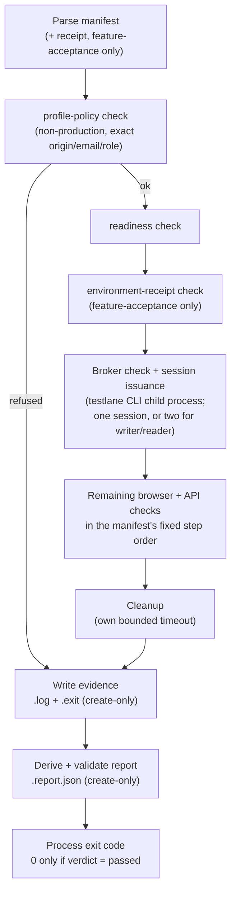
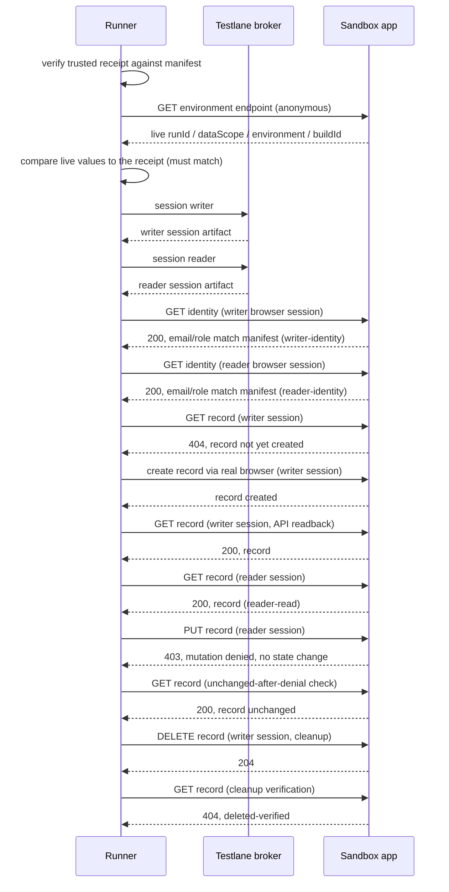
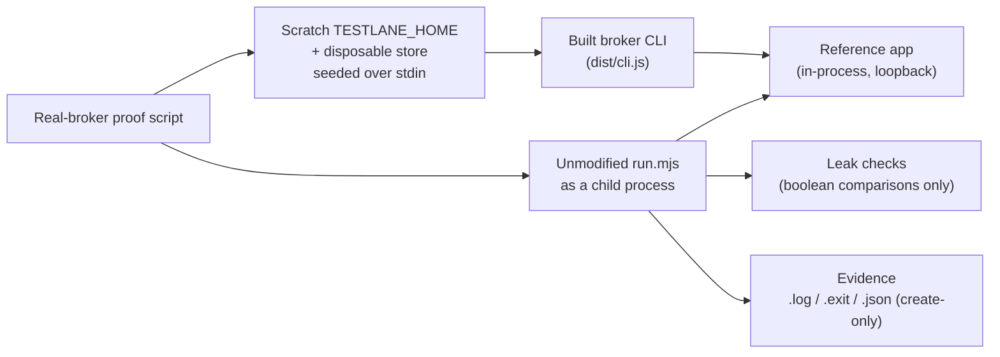

# Workflow templates

Testlane includes two reviewed workflow templates: an **authenticated smoke**
run for a single already-approved profile, and a **feature-acceptance** run
that exercises two distinct accounts as writer and reader against one record-shaped
feature. Both are narrow integration boundaries, not general test runners. A human prepares the
profile(s) and reviews the manifest; the workflow consumes only the broker's
session artifact(s) and records a versioned, secret-free report. Neither
template creates an account, reads a vault, or executes an arbitrary command
string, and **neither template ever handles a password itself**: the only
place a password is typed is the human's own `testlane store set` (prompt or
stdin), or, inside each template's own real-broker proofs and tests, a
throwaway harness that seeds a disposable store the same way, over stdin —
never argv, never a manifest field. Both templates are optional and kept
separate from Testlane's core runtime.

- [How a workflow run works](#how-a-workflow-run-works) — the runner
  lifecycle shared by both templates.
- [Authenticated smoke workflow](#authenticated-smoke-workflow) — read the
  [contract](contracts.md), then use the
  [authenticated-smoke template](../../examples/workflows/authenticated-smoke/README.md).
- [Feature-acceptance workflow (two-role)](#feature-acceptance-workflow-two-role) —
  read the [contract](feature-acceptance-contracts.md), then use the
  [feature-acceptance template](../../examples/workflows/feature-acceptance/README.md).
- [Using the templates from the npm package](#using-the-templates-from-the-npm-package) —
  use supported commands with a project installation, with no checkout.
- [Real-broker proofs](#real-broker-proofs) — what actually exercises the real
  broker CLI, and what it does not.

## How a workflow run works

Both templates share the same runner lifecycle: parse a trusted manifest
(and, for feature-acceptance, a trusted receipt), refuse anything that is not
policy-clean before touching the app, issue session(s) from the broker, run
the remaining checks in a fixed order, always run cleanup, then write
evidence and a validated report before deciding the process exit code.



## Authenticated smoke workflow

An authenticated smoke run for a sandbox or testing web app. It is a narrow
integration boundary for an already approved profile.

### What the workflow checks

The target is loopback-only for the first template: both HTTP and HTTPS are
accepted only for `localhost`, `127.0.0.1` or `[::1]`. Production tags and
production-labelled hosts are refused with no override. The manifest must name
the exact approved profile, target origin, environment, identity and same-origin
paths. It is a trusted, reviewed input; it is not a place to put a password,
cookie, token, session state or command string.

The canonical JSON schemas permit canonical HTTPS origins generally; the current
runner applies the stricter loopback-only policy above.

The run performs these eight checks in order:

1. profile policy
2. readiness
3. broker check
4. session issuance
5. authenticated identity
6. protected page and heading
7. authenticated API
8. anonymous API denial

The app under test adapts to this contract as follows:

- The readiness path returns a successful 2xx response without a redirect. If
  the manifest includes `target.buildId`, the response must include an exact
  matching `X-Build-Id` header; the report records that configured build only
  after the match. With no expected build, `target.actualBuild` remains null.
- The identity path returns HTTP 200 JSON with top-level `email` and `role`
  fields matching the approved identity, using the issued session.
- The protected path renders the exact configured `protectedHeading` as a
  visible heading with the issued session.
- The API path returns 2xx with the issued session and 401 or 403 without it.

The runner uses these responses only for assertions. It does not capture or
store arbitrary response bodies, headers, cookies or other session material.

The report is schema version 1 and has a strict verdict of `passed`, `failed`,
`blocked` or `cancelled`. Every observed step retains its status, reason code,
duration and attempt number. Missing checks, skipped checks and incomplete
cleanup cannot produce a pass. `sourceTree` and `target.actualBuild` are
explicitly nullable: a local checkout hash does not prove which build a remote
application served, so an unknown source or build remains unknown.

The workflow writes only step identifiers, fixed reason codes and report
metadata to evidence. It never writes raw broker output, response bodies,
headers, cookies, screenshots, traces, session captures or secrets. Each run
gets a unique `output/workflow-smoke-<run>.log`, `.exit` and `.report.json`;
failed evidence is preserved rather than overwritten.

### Run it

From a checkout with Node 22 or newer. Chromium is required for the complete
browser checks and for the self-test:

```bash
npm ci
npm run build
npm --prefix examples/workflows/authenticated-smoke install --no-audit --no-fund
# macOS and Windows:
npx --prefix examples/workflows/authenticated-smoke playwright install chromium
# Ubuntu instead:
npx --prefix examples/workflows/authenticated-smoke playwright install --with-deps chromium
npm run workflow:smoke -- --manifest examples/workflows/authenticated-smoke/workflow.json --json
```

If the browser cannot start (most often because Chromium was never
installed), the report says only `launch-failed`; the runner also prints one
hint line on stderr, `workflow smoke hint: …`. For a missing install it names
the executable path Playwright expected and the fix — `npx playwright install
chromium` run inside `examples/workflows/authenticated-smoke` (Ubuntu: `npx
playwright install --with-deps chromium`). For any other launch error it shows
the first line of Playwright's error, trimmed. The hint is for the person at
the terminal: it is never written to the report or the evidence files, and the
error text of a later context or page failure is never printed.

In Windows PowerShell, pass workflow arguments through `cmd` so npm forwards
the double-dash arguments to the runner:

```powershell
cmd /c "npm run workflow:smoke -- --manifest examples/workflows/authenticated-smoke/workflow.json --json"
```

The manifest example targets a loopback app and is a shape example. Point a
run at a reviewed manifest for the app under test. The broker home and profile
registry remain operator-owned; the workflow does not edit a keychain, create
an account, change a home directory, or perform store, account or rotation
operations. The agent never types a password.

To exercise the runner without a broker or a real app, use its synthetic
self-test. It generates the account identity and session value in memory and
uses a private child-process test double:

```bash
npm run workflow:smoke -- --self-test --json
npm run test:workflow
```

The Windows PowerShell form is
`cmd /c "npm run workflow:smoke -- --self-test --json"`.

The self-test proves runner plumbing and the real browser boundary using a
test-only broker double; it is not an authenticated integration result for the
production broker. That real-broker coverage exists separately: see
[Real-broker proofs](#real-broker-proofs) below for the automated proof that
drives the actual built broker CLI against a reference app.

## Feature-acceptance workflow (two-role)

The feature-acceptance template extends the authenticated-smoke contract to a
run that exercises **two distinct accounts**, configured as **writer** and **reader**,
against one record-shaped feature. The manifest requires different profiles and emails;
role labels need not differ. The read/write checks prove effective access. It reuses
the same origin and path rules as the smoke template unchanged, so it is loopback-only in this release too
(see [What the workflow checks](#what-the-workflow-checks) above). Its
`runtime.mjs` imports session and deadline helpers straight from the
authenticated-smoke template's `runtime.mjs`, so the `feature-acceptance`
folder must stay installed next to `authenticated-smoke`, unmoved, for
`run.mjs` to execute at all. It proves:

- the writer can sign in and create a record through a real browser
  (`browser-create`, using the labelled form fields and submit control named
  in the manifest);
- an independent, cookie-authenticated API readback of that record
  (`api-readback`);
- the reader can read the same record (`reader-read`);
- the reader is denied mutating it, with **no state change** on the denied
  request (`reader-mutation-denied`, `unchanged-after-denial`);
- the run cleans up the record it created, and the report says so
  (`cleanup.record`, only `deleted-verified` counts toward a `passed`
  verdict).

**Known limit:** `cleanup.record: "absent-verified"` (distinct from
`deleted-verified`) proves the record's absence only *at cleanup time* — for
example when the app's own create silently no-opped. It says nothing about a
write the app might apply after the runner already gave up on a timed-out or
cancelled request; that gap is why only `deleted-verified`, a delete this run
performed and then confirmed by re-reading, counts toward a `passed` verdict.



Read the [contract](feature-acceptance-contracts.md) for the full manifest and
report schema, the fixed 13-step order (`REQUIRED_FEATURE_STEPS`), the
cleanup record states, and the verdict rules, then use the
[feature-acceptance template](../../examples/workflows/feature-acceptance/README.md)
to point a run at your own app.

### Adapting the feature template to your app

The runner assumes your app under test implements a small application
adapter contract — the shared
[`test-support` reference app](../../examples/workflows/test-support/reference-app.mjs)
is one implementation of it, built only for the templates' own tests and
real-broker proofs, not a stand-in for your app:

- **Readiness** (`checks.readinessPath`): 2xx, no redirect; when
  `target.buildId` is set, an exact matching build-id header before the
  report records `target.actualBuild`.
- **Identity** (`checks.identityPath`): 200 JSON `{ email, role }` for the
  session presented (read from inside a real browser for both roles), 401
  anonymous.
- **Live environment** (`checks.environmentPath`, anonymous): 200 JSON
  `{ runId, dataScope, environment, buildId }`, compared against the trusted
  receipt below.
- **Record creation form** (`record.createPagePath`, writer session): an
  HTML form whose labelled inputs match `record.form.idLabel` /
  `record.form.titleLabel` and whose submit control's visible text matches
  `record.form.submitLabel`; submitting it creates a record and shows
  `record.form.createdText`.
- **Record resource** (`record.collectionPath + "/" + id`): `GET` returns the
  record for the writer or the reader (401 anonymous); `PUT` updates it for
  the writer and returns exactly `403` **with no state change** for the
  reader; `DELETE` removes it for the writer (`403` for the reader).
- **Receipt producer**: a trusted setup adapter — your own CI's provisioning
  step, not part of this runner — that writes a `test-environment-receipt`
  JSON document (schema:
  [`schema/test-environment-receipt.schema.json`](../../schema/test-environment-receipt.schema.json))
  immediately before the run, naming the workflow id, target origin,
  environment, build id, an isolated `dataScope`, and a short validity
  window. This repo's own tests and proofs use
  [`examples/workflows/test-support/receipt.mjs`](../../examples/workflows/test-support/receipt.mjs)
  as a reference implementation of that role.

Full field-by-field rules for every endpoint above live in the
[feature-acceptance contract](feature-acceptance-contracts.md#the-application-adapter-the-runner-expects);
the [template README](../../examples/workflows/feature-acceptance/README.md)
covers pointing `--manifest` and `--receipt` at your own app.

### The trusted receipt, and what it does NOT prove

Unlike the single-profile smoke workflow, a feature-acceptance run also
consumes a **trusted test-environment receipt**: a small, secret-free JSON
document issued by a setup adapter the operator already trusts to have
provisioned an isolated, dedicated-per-run backing store for the app under
test. The runner refuses to proceed past the `environment-receipt` step
(before any broker session is even issued) unless the receipt matches the
manifest's workflow id, origin, environment and build id, is within its
validity window, and — once the app is reached — agrees with what the app's
own anonymous environment endpoint reports.

The receipt is **not cryptographic proof** of an application's backing data.
A loopback host or a `sandbox`/`testing` environment tag alone never
establishes isolated data by themselves; the receipt only lets the runner
refuse a live environment that disagrees with what the manifest and the
adapter agreed on, and lets the report record which `runId`/`dataScope` the
run actually touched. Provisioning a real isolated environment and writing
the receipt honestly is the operator's responsibility, not something this
runner can verify on its own.

### Run it

```bash
npm ci
npm run build
npm --prefix examples/workflows/feature-acceptance install --no-audit --no-fund
# macOS and Windows:
npx --prefix examples/workflows/feature-acceptance playwright install chromium
# Ubuntu instead:
npx --prefix examples/workflows/feature-acceptance playwright install --with-deps chromium
npm run workflow:feature -- --manifest <your-manifest.json> --receipt <your-receipt.json> --json
```

In Windows PowerShell, pass the arguments through `cmd` as for the smoke template:
`cmd /c "npm run workflow:feature -- --manifest <your-manifest.json> --receipt <your-receipt.json> --json"`.

A browser that cannot start is reported as `launch-failed` here too, with the
same one-line `feature acceptance hint: …` on stderr (the expected executable
and the fix for a missing Chromium; run the fix inside
`examples/workflows/feature-acceptance`), and nothing of it in the report.

The template's own tests (`npm run test:workflow-feature`) exercise the
runner against the shared reference app and a test-only broker double, the
same pattern as the smoke template's self-test; they are not a real-broker
integration result either. See [Real-broker proofs](#real-broker-proofs).

## Using the templates from the npm package

Install Testlane and the tested Playwright version in your app repository, then run the
shipped workflow through the CLI. See [project installation](../project-install.md) for
pinned dependency and MCP setup:

```sh
npm install --save-dev --save-exact @testlane/cli@0.6.0 @playwright/test@1.64.0
npx --no-install playwright install chromium
npx --no-install testlane workflow smoke --manifest ./testing/smoke.json --json
npx --no-install testlane workflow feature --manifest ./testing/feature.json --receipt ./testing/environment.json --json
```

Use `npm.cmd` / `npx.cmd` on PowerShell when needed. Both commands run from the app
working directory, resolve its browser dependency, select only a shipped runner and keep
the installed broker entry point fixed. They do not install dependencies or write into the
Testlane package. Reports default to the app's `output/`; choose `--output-dir` if needed.
Feature acceptance still requires a reviewed receipt and permission for disposable record
mutations. These are not automatically allowlisted shell commands.

Both templates ship built inside the npm package, alongside `dist/`. Direct `node run.mjs`
invocation remains available for source/template development with its own optional
Playwright dependency. A global broker can also run the workflow commands from the app
root with app-local Playwright; it does not need npm installs inside the global package.

Copying a template out of the package to somewhere else keeps it working
only if the rest of the package layout stays around it: the built
`dist/workflows/` three directories up from the template
(`<template>/../../../dist/workflows/`), and, for `feature-acceptance`, the
`authenticated-smoke` template folder as its immediate sibling. The in-repo
`tests/`, the shared `test-support` fixtures, and the real-broker proofs are
checkout-only -- npm does not ship them; see each template's own README for
what is and is not included.

## Real-broker proofs

Two proofs drive the **actual built broker CLI** (`dist/cli.js`, not a test
double) end to end: a real HTTP sign-in against an in-process reference app,
the real vault store, policy and audit path, and a real headless Chromium
browser, using generated in-memory accounts and a disposable, throwaway
secret store.

Each template's `node_modules` (Playwright included) is separate, so each needs its own
`npm --prefix examples/workflows/<template> install --no-audit --no-fund` before its proof
runs -- installing it for `authenticated-smoke` does not also install it for
`feature-acceptance`, or vice versa. Only the Chromium *browser download*
(`npx --prefix examples/workflows/<template> playwright install chromium`) is effectively
shared once fetched. See each template's "Run it" section above for the exact commands.

- `npm run proof:smoke-real-broker -- --json` — runs the unmodified
  authenticated-smoke `run.mjs` CLI for three cases (`happy`, `wrong-secret`,
  `production-host`).
- `npm run proof:feature-real-broker -- --json` — runs the unmodified
  feature-acceptance `run.mjs` CLI for four cases (`happy`,
  `deny-but-mutate`, `missing-receipt`, `wrong-identity`).



Both proofs need a supported platform, checked by `realBrokerSupport()`:
**Windows** via the real DPAPI store, always; **Linux** via the real
Secret Service store only inside an isolated `dbus-run-session` with a
throwaway `gnome-keyring`, and only when `TESTLANE_REAL_KEYCHAIN=1` is set;
**never macOS**, and never an un-opted-in Linux shell — a scratch
`TESTLANE_HOME`/`AGENT_AUTH_HOME` does not isolate an OS keychain from the
real one, so both proofs refuse (exit 2, "blocked") rather than silently pass
or touch a real credential store. A missing build or missing Chromium also
blocks (exit 2), never a silent skip. Exit `0` means every case met its
expectation; exit `1` means at least one case failed. Every leak check
(generated passwords, every minted session token) is a boolean comparison —
`text.includes(needle) === false` — never a comparison that could echo a
secret, checked across stdout/stderr, evidence files, the manifest, the
registry and the scratch audit log. `TESTLANE_REAL_KEYCHAIN` itself only
gates this preflight check; it has no effect on the broker CLI or its own
store selection (`TESTLANE_STORE`) outside these proofs.

**This is not a consumer-app pilot.** The reference app the proofs run
against ([`examples/workflows/test-support/reference-app.mjs`](../../examples/workflows/test-support/reference-app.mjs))
is a dependency-free fixture built for these proofs; it stands in for a real
application under test so the real broker, real HTTP sign-in, and real vault
path can be exercised in CI without a consumer repo, a shared database, or a
deployment. It shows the templates work against *some* real app end to end;
it does not stand in for testing your own application's actual login form,
roles or record semantics.

CI runs both proofs on `windows-latest` (DPAPI) and `ubuntu-latest` (isolated
D-Bus session + throwaway keyring); never on macOS, for the same reason
described above.
